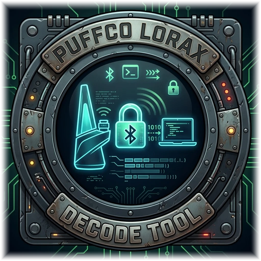

<p align="center">
  
</p>

# puffco-lorax-decode

A small Python decoder for Puffco **LORAX** BLE traffic. Feed it an Android
`btsnoop_hci.log` and it prints the auth handshake, every device path the app
read with its value decoded by type, and every control command it wrote.

LORAX is the path-based command channel the newer Puffco firmware (New Proxy /
Peak Pro) uses instead of the old one-characteristic-per-field GATT. This is the
decoder from my write-up on reverse-engineering it:
**[Reverse-Engineering a Bluetooth LE Protocol from Android](https://magikh0e.pl/pubHardwareHacking/reversing-bluetooth-le-android.html)**,
where the whole method (capture, decode, read the app for the auth secret) is
walked through end to end.

**Full reference → the [project wiki](https://github.com/magikh0e/puffco-lorax-decode/wiki):**
the [protocol](https://github.com/magikh0e/puffco-lorax-decode/wiki/Protocol-Reference)
(frame format, opcode set, auth handshake), the complete device
[path map](https://github.com/magikh0e/puffco-lorax-decode/wiki/Path-Map), and the
[control sequences](https://github.com/magikh0e/puffco-lorax-decode/wiki/Driving-the-Device)
— in more depth than this README.

## Usage

```bash
python3 puffco_lorax_decode.py btsnoop_hci.log [--json out.json] [--csv out.csv]
```

No dependencies beyond the Python 3 standard library.

Grab the capture from an Android phone with Developer Options → **Enable
Bluetooth HCI snoop log**, pair and use the real app, then pull
`btsnoop_hci.log` off the device. Start the log *before* the app connects if you
want the auth handshake in it.

## What it prints

- **Auth** — the `getAccessSeed` → `unlock` pair, and whether the computed
  token matches the one the app actually sent (a known-answer check that your
  handshake code is right).
- **Device path map** — every `readShort` path the app pulled, with the value
  decoded as float32 / u32 / string / rgb / mac / bytes, plus a short
  description. `--json` / `--csv` write the same table to a file.

## Live client: `puffco_client.py`

The decoder works offline, from a capture. The companion client goes the other
way round: it connects to a Puffco over BLE, runs the LORAX auth handshake, and
reads live device state (battery, heater temp, serial, profiles, and so on) using
the same seqId transaction model. Cross-platform via
[`bleak`](https://github.com/hbldh/bleak).

```bash
pip install bleak
python3 puffco_client.py                      # auto-scan for a Puffco
python3 puffco_client.py --name "PEAK PRO"
python3 puffco_client.py --address AA:BB:CC:DD:EE:FF
```

> **Pairing is required.** The Peak Pro only answers over a **paired, encrypted**
> link — unpaired, it silently ignores every LORAX frame and the client just
> hangs on timeouts (reading the OTA version char returns ATT `0x0F` "Insufficient
> Encryption"). Put the Peak in pairing mode (hold the button until the logo glows
> blue) and pair it with your OS first. On Windows, Settings/Chrome often won't
> pair it — use a ConfirmOnly custom pairing (`DeviceInformationCustomPairing`);
> if it sticks on `OPERATION_ALREADY_IN_PROGRESS`, reboot to clear it.

Reading live state, the auth handshake, starting/stopping a heat cycle (with
temp/time overrides), and the mood light are **live-verified** on a real Peak Pro
(fw gith `5652c02`, bleak 3.1 / Chrome 157). The remaining writes are mapped from
the app but not yet hardware-tested — see the roadmap below.

## Protocol, in short

```
frame = seqId (uint16 LE) + opcode (uint8) + payload
```

| | UUID | role |
|---|---|---|
| command | `60133d5c-…` | write without response |
| reply | `8dc5ec05-…` | notify (command replies) |
| event | `43312cd1-…` | notify (async events) |

LORAX is a small **file-access protocol** — the paths are files, and
`readShort` / `writeShort` are shorthand for open+read / open+write+close. The
full opcode set:

| group | opcodes |
|---|---|
| auth / session | `0x00` getAccessSeed · `0x01` unlockAccess · `0x02` getLimits · `0x03` ackEvents |
| shorthand | `0x10` readShort · `0x11` writeShort · `0x12` statShort · `0x13` unlink |
| file handles | `0x20` fileOpen · `0x21` fileRead · `0x22` fileWrite · `0x23` fileWatch · `0x24` fileUnwatch · `0x25` fileStat · `0x26` fileClose · `0x27` pruneFileHandles |

A reply is `seqId(2) + status(1, 0x00=OK) + data`. Payloads:
`readShort = offset(u16) maxLen(u16) path`;
`writeShort = offset(u16) flags(u8) path 0x00 data` (flags: truncate = `0x04`).
Device state is addressed as filesystem-like paths (`/p/bat/soc`,
`/p/app/htr/temp`, …); the type registry in the script maps the ones I've
identified.

The registry here is the **Peak Pro** (codename *Pikachoid*, apiSeries 0) table,
where values are mostly float32. A **Proxy** (*Toad*, apiSeries 1) reports the
same paths as int32 with a scale divisor — so `/p/bat/soc` is float32 on a Peak
Pro but int32/100 on a Proxy. Detect the variant from `/p/sys/fw/api`
(`apiSeries = value >> 16`).

## Driving the device

These are the command sequences the official Puffco Connect 3.13.47 app uses,
recovered by decompiling it. Each step is a `writeShort` (opcode `0x11`) to a
path. **Start, stop, the temp/time overrides, and the mood light (lantern on and
off) are live-verified on a Peak Pro** (start preheats and `/p/app/htr/temp`
climbs); device power off is from the app and not yet hardware-tested:

```
start cycle   /p/app/hcs = <index> (i8)    then   /p/app/mc = 7      [verified]
stop cycle    /p/app/mc = 8                 then   /p/app/mc = 2      [verified]
+temp         /p/app/tmpo = <delta C> float32  (+10 F = 5.5556)      [verified]
+time         /p/app/timo = <seconds> float32  (e.g. 10.0)           [verified]
lantern on    /p/app/ltrn/colr = <color>  then  ltrn/cmd = 1  then  ltrn/time = 7200  [verified]
lantern off   /p/app/ltrn/cmd = 0                                            [verified]
power off     /p/app/ltrn/cmd = 0           then   /p/app/mc = 0      [from app]
```

The temp/time overrides apply during an active heat cycle.

`/p/app/mc` is the mode command (`7` start, `8` abort, `2` idle, `0` off; the app
never sends `9`/boost). LED/lantern colors (`/p/app/led/*`, `/p/app/ltrn/colr`)
are 8 bytes: `r, g, b, 0, lumaAnim, 0, 0, 0`, where byte 3 selects the source —
`0` a plain RGB color (hardware-confirmed for the lantern), `1` an animation
table, `255` none — and `lumaAnim` is PRESERVE 0 / STEADY 1 / BREATHING 5 /
RISING 6 / CIRCLING 7. Every write carries `flags = truncate (0x04)` at
`offset 0` — that's the `bp=4` the decoder reports.

## Credit

The protocol was confirmed against my own captures plus prior work. The LORAX
UUIDs and the path model match
[austenstone/puffco-mcp](https://github.com/austenstone/puffco-mcp).
[Fr0st3h's write-up](https://github.com/Fr0st3h/Puffco-Reverse-Engineering-Writeup)
documents the *older* one-characteristic-per-field firmware — a different GATT
layout and a different handshake constant — but the same
`SHA-256(secret ++ seed)[:16]` auth scheme carried over to LORAX.

The full opcode set (LORAX is a file-access protocol), the
`readShort`/`writeShort` payload layouts, and the control sequences above were
recovered by **decompiling the official Puffco Connect 3.13.47 app** while
building my own Puffco Pro control webapp — this is the protocol the shipping app
uses. That app carries three handshake keys, one per firmware generation: `flatA`,
`flatX` (which is exactly Fr0st3h's constant, `FUrZc0WilhUBteT2JlCc+A==`), and
`lorax` (`ZMZFYlbyb1scoSc3pd1x+w==`, the one this decoder uses).

## Status / work in progress

This decoder is step one of a bigger itch: there's no official public API for
these devices, so the only way to talk to a Puffco you own on your own terms is
to work out the protocol from the wire. This repo *reads* — it turns a capture
into a documented path map — and it's the protocol reference behind a separate
control webapp that now **pairs with a real Peak Pro, authenticates, reads live
state, starts/stops a heat cycle with temp/time overrides, and runs the mood
light**: a small, dependency-light alternative to the official app. I did the same
reverse-engineering route for Storz & Bickel (see
[volcano-hybrid-control](https://github.com/magikh0e/volcano-hybrid-control) and
[home-assistant-volcano-hybrid](https://github.com/magikh0e/home-assistant-volcano-hybrid));
this is the early, exploratory version of that for LORAX.

What's mapped so far:

- The frame format, the command/reply/event channels, and the **full opcode set**
  — LORAX is a file-access protocol (open/read/write/watch/stat/close), with
  `readShort`/`writeShort` as the shorthand ops.
- The auth handshake — **live-verified on a real Peak Pro** (the `lorax` key
  unlocks it, status 0; `getLimits` → maxPayload 241, maxFiles 36, maxCommands 8).
- A chunk of the `/p` and `/u` path tree with types (battery, heater, odometer,
  profiles, lantern, LEDs, device info); the float32 reads are live-verified.
- **Start/stop a heat cycle, the temp/time overrides, and the mood light (lantern
  on/off)** are live-verified on a Peak Pro; device power off and the rest are
  mapped from the app — see above.

Still open, and where help is useful:

- The remaining writes — profile edits, stealth, ready-mode, brightness, and
  device power off (`ltrn/cmd` 0 then `mc` 0) — are mapped from the app but not
  yet round-tripped on hardware.
- The event channel (`43312cd1-…`): the app subscribes with `fileWatch` (`0x23`)
  and acks with `ackEvents` (`0x03`), but the event *payloads* aren't decoded.
- Proxy (*Toad*) support: the same paths reported as int32-with-scale, not float32.
- Folding in the fuller ~191-path typed registry from the app's field spec
  (read/write attrs, enum labels, firmware gates).

A useful lead for those write opcodes:
[Fr0st3h's write-up](https://github.com/Fr0st3h/Puffco-Reverse-Engineering-Writeup)
lists the older firmware's command set (heatCycleStart, heatCycleAbort, bonding,
lighting modes). It's a different generation and a different wire format, but the
device *behaviours* are the same — so it's a decent map of **which commands exist**
to match against the LORAX writes when decoding them.

If you've captured something new, or decoded a path the registry doesn't know,
**[Discussions](https://github.com/magikh0e/puffco-lorax-decode/discussions)** is
the place — there's a form for findings. This is exploratory and done on my own
devices; nothing here is affiliated with or endorsed by Puffco.

## Legality

I reverse-engineered this from a device I own, using my own captures, so my own
software can talk to it. In the U.S. that's the interoperability case the DMCA
carves out — **§1201(f)**
([17 USC §1201](https://www.law.cornell.edu/uscode/text/17/1201)): if you
lawfully have a copy of a program, you may circumvent its access controls and
reverse-engineer it for the sole purpose of making an independently created
program interoperate with it, where interoperability is just programs exchanging
information and using it (§1201(f)(4)). An unofficial client for a device with no
public API is exactly that.

This repo documents a wire protocol — it doesn't redistribute Puffco's app or
firmware. Use it on hardware you own; don't point it at devices that aren't
yours. None of this is legal advice.

## License

GPL-3.0. See [LICENSE](LICENSE).
